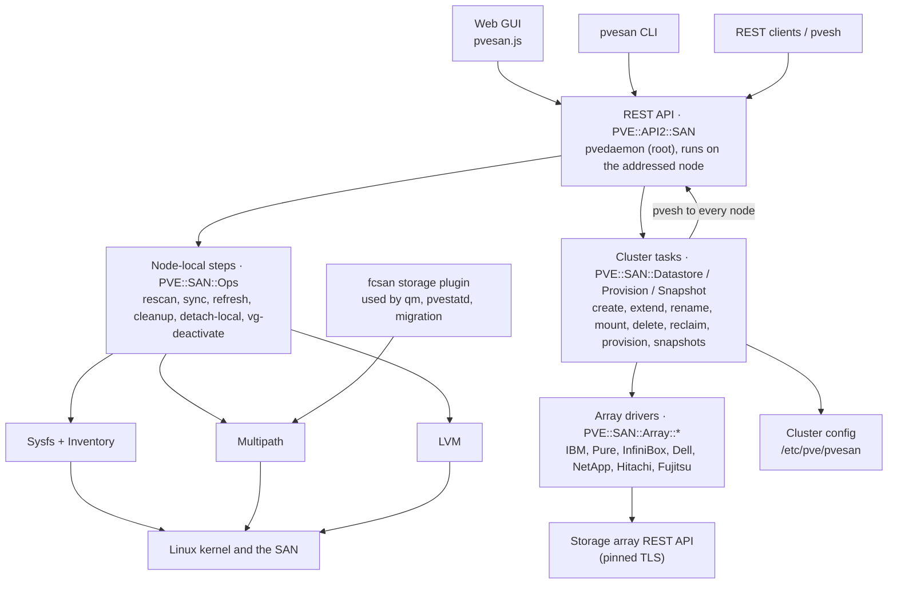

# pve-fcsan: How It Works

Version 1.4.0

## Goals and the stack mapping

pvesan rebuilds the vCenter SAN workflow on top of parts Proxmox VE already trusts: dm-multipath for paths, shared thick LVM for the datastore, and pmxcfs for cluster state. It adds no on-disk format and no kernel code. If you remove pvesan, the datastores are still ordinary LVM storages.

**Goals, in priority order**

1. Never lose or corrupt data. Every destructive step checks usage on every node first, and LVM metadata changes only happen under Proxmox VE's own cluster storage lock.
2. Match the vCenter operator experience: the same verbs, run cluster-wide from any node, with a task log.
3. Stay upgrade-safe. Change as little of pve-manager as possible, and re-apply those changes automatically after an upgrade.
4. Keep GUI, CLI and API identical, by building the CLI and GUI on the API.

| Layer | ESXi / vCenter | Proxmox VE + pvesan |
| --- | --- | --- |
| HBA and transport | vmhba, FC driver | `qla2xxx` / `lpfc`, `/sys/class/fc_host` |
| Device identity | `naa.` device ID | SCSI WWID (`3` + NAA hex), same value |
| Multipathing | NMP with SATP and PSP | dm-multipath; the policy maps onto `path_grouping_policy`, `prio` and `failback` |
| Device display name | Device display name | Multipath `alias` (`/dev/mapper/<alias>`), kept cluster-wide |
| Datastore file system | VMFS, a clustered FS with on-disk locks | Shared thick LVM VG; metadata serialized by the pmxcfs cluster lock |
| VM disk | VMDK file on VMFS | One LV per disk (raw, or a qcow2 volume chain on Proxmox VE 9) |
| Datastore registry | vCenter inventory | `/etc/pve/storage.cfg` entry of type `fcsan` |
| Cluster-wide config | vCenter DB, host profiles | `/etc/pve/pvesan/config.json` on pmxcfs |
| Rescan | `esxcli storage core adapter rescan` | sysfs `scan` and `rescan`, then a multipathd resize |
| Detached device | Device state `off` | WWID blacklisted, paths deleted, removed again after each rescan |
| Array plugin (Pure, InfiniBox, ...) | vSphere plugin | pvesan array drivers |

The largest difference is the datastore layer. VMFS lets many hosts allocate space at the same time using on-disk locks. Shared LVM has one metadata writer at a time, enforced with a cluster-wide lock, while data I/O to existing LVs runs in parallel on every node. So the design rule is: metadata changes (create, extend, resize, delete) go through the lock, data paths never do.

## Architecture

The GUI, the CLI and REST clients all call one API. A cluster task runs on the node it was called on and reaches every other node through that same API. The storage plugin is the only piece Proxmox VE itself calls, from `qm`, `pvestatd` and migration.



| Component | File | Integration point |
| --- | --- | --- |
| Storage type `fcsan` | `PVE/Storage/Custom/FCSANPlugin.pm` | Proxmox VE loads every module in `Storage/Custom`. It subclasses `LVMPlugin` and overrides `activate_storage`, `free_image` (opt-in discard), `options` and `properties` |
| REST API | `PVE/API2/SAN.pm` | Registered as `/nodes/{node}/san` by one marked line in `PVE/API2/Nodes.pm` |
| CLI | `PVE/CLI/pvesan.pm`, `/usr/sbin/pvesan` | `PVE::CLIHandler` maps each command onto an API method |
| GUI | `/usr/share/pve-manager/js/pvesan.js` | One `<script>` line in `index.html.tpl`; an Ext `override` of `PVE.panel.Config` adds the panel to the node's Disks group |
| Integration | `/usr/share/pve-fcsan/pvesan-integrate` | Run by `postinst`, re-run by a dpkg trigger when pve-manager replaces either file |
| Health timer | `pvesan-monitor.timer`, `pvesan-alert-*.txt.hbs` | `pvesan monitor-run` every 5 minutes on every node; alerts through `PVE::Notify` |
| Boot sync | `pvesan-sync.service` | `pvesan sync` after `pve-cluster` and `multipathd`, before `pvestatd` and guests |
| Timers | `pvesan-snapshot.timer`, `pvesan-reclaim.timer` | `pvesan snapshot-run` every 15 minutes and `pvesan reclaim-run` weekly on every node; a claim in the cluster DB picks one node per job |
| Array drivers | `PVE/SAN/Array/*.pm` | Called only by provisioning workflows |

## Data model

State lives in three places, each with one owner; each node renders a fourth from them.

| Store | Location | Holds | Written by |
| --- | --- | --- | --- |
| Storage registry | `/etc/pve/storage.cfg` (pmxcfs) | `fcsan` entry: `vgname`, `shared`, `nodes`, `disable`, `fc-wwids`, `fc-autorescan`, `fc-discard` | Proxmox VE storage API (`PVE::API2::Storage::Config`) |
| pvesan cluster DB | `/etc/pve/pvesan/config.json` (pmxcfs) | Per WWID: `alias`, `policy`, `detached`, `datastore`. Per datastore: `label`, linked `array` and `volumes`; for a snapshot copy `copy_of` and `snapshot`; `snapshot_schedule`, `auto_reclaim` and job state. Per array: type, address, user, fingerprint, vendor settings | `PVE::SAN::Config::update` under the `pvesan` cfs domain lock |
| Array secrets | `/etc/pve/priv/pvesan/<array>.pw` | Password or API token | Root only |
| Monitor cache | `/etc/pve/pvesan/monitor.json` (pmxcfs) | Array views per datastore, array problems, lease, member list per array | `PVE::SAN::Monitor` under the `pvesan` domain lock |
| LVM metadata | On the LUNs | VG, PVs, LVs | LVM commands, only under `cluster_lock_storage` |
| Rendered, per node | `/etc/multipath/conf.d/pvesan.conf`, `/etc/multipath/wwids`, LVM devices file | Aliases, policies, blacklist of detached WWIDs, claimed WWIDs | `PVE::SAN::Ops::sync` |
| Node health state | `/var/lib/pvesan/health.json` | Highest path count seen per LUN, last reported problems | `PVE::SAN::Monitor` on that node |

**Why a separate cluster DB?** Aliases and path policies apply to LUNs, not storages: a LUN can have a policy before it belongs to a datastore, and a detached LUN belongs to none. `storage.cfg` has no place for that, so pvesan keeps a small JSON file next to it on pmxcfs.

**Rendering.** `render_conf()` is a pure function (device table in, multipath snippet out, sorted by WWID), so the same input always gives the same bytes. `sync` writes the file and runs `multipathd reconfigure` only when the content changed, which makes it cheap and safe to run at boot, during activation, and twice in every create.

```
multipaths {
	multipath {
		wwid 3600a098038303053453f463045727a41
		alias ds1
		path_grouping_policy group_by_prio
		prio alua
		path_selector "service-time 0"
		failback immediate
	}
}
```

**Identity.** Everything is keyed by WWID, never by `sdX` or `dm-N`, which change across reboots and differ between nodes. sysfs gives `naa.<hex>`; pvesan turns it into multipath's form, `3<hex>`. For vendor-specific (t10) IDs it calls `scsi_id`, the same source multipath uses.

**Usage classification.** For each LUN, `Inventory::devices` decides one usage, in this order: `datastore:<id>`, `lvm-vg:<vg>`, `lvm-pv`, `in-use:<holders>`, `signature:<type>` / `partitioned:<type>` (from blkid), `free`. Only `free` LUNs can be used without `force`; the first four are never wiped.

## Operation internals

Every cluster operation follows the same pattern:

1. Check the situation on every node through the API.
2. Change cluster state on pmxcfs.
3. Apply that state on every node.
4. Make the single LVM metadata change on the coordinating node, under the lock.

The fan-out (`PVE::SAN::Cluster::on_nodes`) calls `pvesh <verb> /nodes/<n>/san/<step>` for each node, the local one included, so every node runs the same code. It collects every node's failure before it aborts, so one task log shows all problems.

**Rescan (`Ops::rescan`).** Snapshot the SAN paths; optionally issue a LIP per port and wait for `Online`; write `- - -` to each FC/iSCSI host's `scan`; write `1` to each known path's `rescan` to re-read capacity; `udevadm settle`; delete paths of detached WWIDs; `multipathd resize map` for maps whose paths grew; return the difference.

**Sync (`Ops::sync`).** Render the snippet, write it if changed, and add or remove WWIDs in `/etc/multipath/wwids`. pvesan edits that file directly instead of calling `multipath -a`, which needs the LUN to be visible, and not every node sees every LUN. If anything changed, run `multipathd reconfigure` and wait for the maps of LUNs this node has paths to; add them to the LVM devices file when it is enabled.

**Create (`Datastore::create`).**

1. Refuse if the storage ID or VG exists.
2. `check_visible`: every target node must see each WWID with an active path.
3. `check_unused_locally`: classify each LUN.
4. `register_devices`: alias in the cluster DB, `sync` on all nodes, wait for `/dev/mapper/<alias>`.
5. `wipefs` (only with `force`), `pvcreate`, `vgcreate --addtag pvesan`.
6. `PVE::API2::Storage::Config->create(type => 'fcsan', shared => 1, ...)`, the same call Proxmox VE's own Disks → LVM wizard makes.
7. Roll back with `vgremove`/`pvremove` if step 5 or 6 fails; finally `sync` everywhere again.

**Extend.** *Grow* runs `devices/{wwid}/refresh` on every node (re-read size, resize map) and aborts if the nodes disagree; only then `pvresize` under `cluster_lock_storage`. *Add extent* reuses steps 2–5 of create, then `vgextend` under the lock and updates `fc-wwids`.

**Rename.** A label rename touches only the cluster DB. An ID rename requires every node online and no running guest that refers to the storage, deactivates the VG everywhere, moves the `storage.cfg` section (and optionally runs `vgrename`) inside `lock_storage_config`, then rewrites `^key: <id>:` references in every guest config, snapshot sections included.

**Unmount and mount** map onto Proxmox VE's two switches: removing nodes from `nodes`, or `disable 1`. The VG is deactivated on the affected nodes first, and `vg-deactivate` refuses if any LV is open.

**Delete** refuses while guest configs refer to the storage or LVs remain (without `destroy-data`), deactivates everywhere, deletes the storage through the API, runs `vgremove`/`pvremove`/`wipefs`, cleans the cluster DB and optionally detaches the LUNs.

**Detach** asks every node whether the LUN is in use, marks it `detached` (which blacklists and unclaims it on `sync`), then runs `detach-local` on every node to flush the map and delete each path. Every later rescan deletes the paths again.

**Reclaim** checks `discard_max_bytes > 0` on each backing map, creates `pvesan_reclaim` over the free space minus a reserve under the storage lock, releases the lock, runs `blkdiscard`, and removes the LV again under the lock.

**Activation (`FCSANPlugin::activate_storage`).** Before handing over to `LVMPlugin`, the plugin checks that each WWID in `fc-wwids` has a map. If one is missing and `fc-autorescan` is on, it runs a local rescan and sync, rate-limited to once per 5 minutes per storage by a stamp file in `/run/pvesan`. If the map is still missing, activation fails with a clear message and the storage shows inactive on that node only.

## Array integration

Array drivers turn pvesan from a SAN manager into a provisioning tool. The array becomes one more layer pvesan drives, ahead of the steps above.

| Module | Role |
| --- | --- |
| `PVE::SAN::Array` | Registry of array types to drivers; array settings in the cluster DB, secrets in `/etc/pve/priv/pvesan/`; certificate probe; collects every node's WWPNs |
| `PVE::SAN::Array::Base` | Shared driver code: TLS-pinned HTTP client, naming rules, vendor-neutral host and host-cluster registration |
| `PVE::SAN::Array::<Vendor>` | One module per platform |
| `PVE::SAN::Provision` | Workflows: register the cluster, provision, grow, destroy with the volume, link |

**Driver contract.** A driver implements `system_info`, `pools`, `hosts`, `host_clusters`, `create_hostcluster`, `create_host`, `add_host_ports`, `add_to_hostcluster`, `create_volume`, `volume`, `find_volume_by_wwid`, `map_to_hostcluster`, `unmap_from_hostcluster`, `expand_volume` and `delete_volume`. A volume always comes back with its multipath WWID, which connects array objects to everything else in pvesan. Drivers whose arrays present volumes differently override `ensure_hostcluster`. Three hooks cover vendor differences: `options` (required settings such as `svm` or `portgroup`), `valid_hostcluster_name`, and `wwid_after_map`.

**Trust.** No connection is made without a pinned SHA-256 certificate fingerprint. `array-probe` reads it, the admin compares it with the array's own display, and from then on only that certificate is accepted. Hostname checks are off because the pin is stronger than CA trust for the usual self-signed array certificate. Credentials are tested before anything is saved.

**Registration** (`ensure_hostcluster`) is idempotent. For each node, an array host that already owns any of its WWPNs is reused and missing ports are added; otherwise a host named after the node is created (with "force", because ports may not be logged in until zoning is done). Every host then joins the cluster's host cluster. Ports split across hosts, or a host already in another host cluster, are refused: fixing those is an admin decision on the array.

**Provision** runs inside one task: register the cluster; create the volume; map it; rescan every 30 s and poll every node every 10 s until each node has an active path (up to 120 s); record the path policy; run the normal datastore create; store the link `datastores.<id> = { array, volumes[] }`. If anything fails before the datastore exists, the task unmaps the volume, cleans dead paths on all nodes, deletes the volume and drops the device record.

| Platform | API | Checked against | How the cluster is presented | Volume ID → WWID |
| --- | --- | --- | --- | --- |
| IBM Spectrum Virtualize | `POST /rest/v1/<cli-command>[/<obj>]`, token from `/auth` | IBM REST API reference | Host cluster | `3` + `vdisk_UID` |
| Pure FlashArray | `/api/2.x/...`, API token → `x-auth-token` | Pure's generated SDK docs (go-pure-client) | Host group; mapping = connection | `3624a9370` + serial |
| INFINIDAT InfiniBox | `/api/rest/...`, Basic auth, `approved=true` on changes | InfiniSDK source | Cluster; LUN on the cluster, unmapped by LUN number | `36` + serial |
| Dell PowerStore | `/api/rest/...`, `login_session` → `DELL-EMC-TOKEN` + cookie | PyPowerStore | Host group (created with its first host) | `wwn` |
| Dell PowerMax / VMAX | Unisphere `/univmax/restapi/<ver>/sloprovisioning/symmetrix/<id>` | PyU4V | Host group + storage group `<hc>_SG` + masking view `<hc>_MV`; volumes created in the SG | `effective_wwn` |
| NetApp ONTAP | `/api/...`, jobs awaited | `netapp.ontap` Ansible modules | One FCP igroup; one FlexVol + LUN per datastore | `3600a0980` + hex(serial) |
| NetApp E-Series | `/devmgr/v2/storage-systems/<ssid>` | SANtricity Ansible collection | Host group (Linux DM-MP host type) | `wwn` |
| Hitachi VSP | `/ConfigurationManager/v1/objects/storages/<id>`, session token, jobs awaited | OpenStack Cinder Hitachi driver, Configuration Manager reference | One host group per target port; LU path on each | `naaId` (known after mapping) |
| Fujitsu ETERNUS DX S5 / AF S3 | `:5665/api/v1/...`, `POST session` → Bearer token, jobs awaited and deleted | ETERNUS RESTful API Reference (P3AG-5492) | One FC host per WWN (the API has no host groups); every volume connected to all of them with one host LUN | `3` + `uid` |

### Array snapshots and copies

`PVE::SAN::Snapshot` builds the datastore-level workflows on five optional driver primitives: `snapshot_create(\@vols, $name)` (one point in time for all volumes), `snapshots(\@vols)`, `snapshot_delete`, `snapshot_clone` (a new writable, unmapped volume) and `snapshot_restore` (overwrite a volume in place). `supports_snapshots` and `supports_group_snapshots` say what a driver can do; the base class dies with "not supported yet" for the rest.

| Platform | Snapshot | Several volumes | Clone | Restore in place | Checked against |
| --- | --- | --- | --- | --- | --- |
| Pure FlashArray | `POST volume-snapshots?source_names=<vol>` `{suffix}` | Protection group `pvesan-<vol>`, `POST protection-group-snapshots` | `POST volumes` `{source}` | `POST volumes?overwrite=true` `{source}` | go-pure-client FA 2.50 docs |
| INFINIDAT InfiniBox | `POST volumes` `{name, parent_id, write_protected}` | `POST volumes/group_snapshot` | Writable child of the snapshot | `POST volumes/<id>/restore` | InfiniSDK (`dataset.py`, `volume.py`) |
| Dell PowerStore | `POST volume/<id>/snapshot` `{name}` | Not yet (volume groups) | `POST volume/<snap>/clone` | `POST volume/<id>/restore` `{from_snap_id, create_backup_snap}` | PyPowerStore (`protection.py`, `provisioning.py`) |

A **snapshot set** is every array snapshot with the same pvesan name across the datastore's volumes (`group_sets`); a set missing a volume is listed as incomplete and can't be mounted or rolled back. A group snapshot (Pure protection group) is deleted once, not per member.

**Mount as copy.** Clone each member, map the clones, `wait_visible`, register the devices under the copy's ID (aliases, multipath), then `vgimportclone --basevgname san_<copy>` on the coordinating node, which writes new PV and VG UUIDs so LVM never sees two VGs with the same identity for longer than the import. Every LV is set read-only (`lvchange --permission r`) and the copy is registered as an `fcsan` storage with content `images`. The cluster DB records `{ array, volumes, copy_of, snapshot }`, so remove-copy is the normal delete-with-volume. A failure at any step unmaps and deletes the clones again.

**Restore a VM.** The VM's current config gives the disks on the datastore; each one present in the copy is copied with `qemu-img convert -n` (raw over the live LV with the VM stopped, or converted to raw into newly allocated volumes for a new VM ID). A disk that is a qcow2 volume-chain layer with a backing file in the copy is refused, because it can't be restored on its own. `new_vm_config` (a pure function, unit tested) rewrites the config for a new VM: disks remapped, other storages dropped, new MACs, SMBIOS UUID and vmgenid, links down.

**Roll back.** Requires a typed confirmation, every guest stopped, every node of the datastore online and no mounted copy. The storage is disabled, the VG deactivated on all nodes, each volume restored by the array, every node re-reads the LUNs, and the storage is enabled again.

**Schedules.** The cluster DB holds `snapshot_schedule = { interval, keep }`, `auto_reclaim` and per-job state `{ last, error, claimed }`. `pvesan-snapshot.timer` (every 15 minutes) and `pvesan-reclaim.timer` (weekly) fire on every node. Each run reads the config without a lock and returns at once if nothing is due; otherwise it claims the due jobs under the `pvesan` domain lock (a claim older than 6 hours is taken over, in case a node died mid-run), runs them outside the lock and records the result. Retention removes only `auto-<date>-<time>` snapshots beyond `keep`, never manual or mounted ones.

## Consistency, locking, safety, permissions

The one invariant: **only one node at a time writes LVM metadata for a shared VG, and every node sees the same device size before LVM is told about it.**

| Lock | Taken through | Guards | Held for |
| --- | --- | --- | --- |
| Cluster storage lock | `PVE::Storage::Plugin->cluster_lock_storage($id, 1, 60, ...)` | `pvcreate`/`vgextend`, `pvresize`, reclaim LV create/remove; Proxmox VE's own volume allocation takes it too | Seconds |
| Monitor lease | A `{ node, time }` entry in `monitor.json`, written under the `pvesan` domain lock | Which node reads the arrays this run | One timer interval |
| storage.cfg lock | `PVE::Storage::lock_storage_config` | ID rename (section move plus `vgrename`) | Seconds |
| pvesan domain lock | `cfs_lock_domain('pvesan')` | Read-modify-write of `config.json`, and the claim of scheduled snapshot and reclaim jobs | Milliseconds |

pmxcfs aborts code holding a lock for more than 60 s, so every slow step (node fan-out, waiting for maps, `blkdiscard`, array calls) stays outside locks.

**Safety rails**

- Visibility gate: create and extend abort unless every target node sees each LUN; grow aborts if nodes report different sizes.
- Usage gate: LUNs in use as a datastore, VG, PV or with holders are never wiped; signatures and partitions need explicit `force`.
- Reference gate: delete, ID rename and unmount refuse while guest configs refer to the storage or those guests run on the target nodes.
- Open-volume gate: `vg-deactivate` refuses while any LV is open.
- Rollback: a failed create removes the VG/PVs it made; a failed provision deletes the new array volume.
- Typed confirmation for Delete and Detach in the GUI.
- Integration guard: the line in `Nodes.pm` loads pve-fcsan inside an `eval`, so a pve-fcsan that fails to load disables only `/nodes/{node}/san` (with a warning in the journal), never the rest of the API. `pvesan-integrate` runs `perl -c` on the patched `Nodes.pm` and reverts if it fails. The GUI override catches its own errors, so a broken `pvesan.js` loses only the SAN panel.
- Uninstall guard: `prerm` refuses while `fcsan` storages exist.

**Permissions.** API calls are `protected` (handled by pvedaemon as root) and `proxyto => 'node'`. Reads need `Sys.Audit` on the node; node-local changes `Sys.Modify` on the node; anything cluster-wide or array-related `Sys.Modify` on `/` and `Datastore.Allocate` on `/storage`. Those privileges allow root-level storage changes on every node, the same as Proxmox VE's own storage management.

## Monitoring and health

`PVE::SAN::Monitor` gives the vSphere plugins' storage health view inside Proxmox VE, without a separate daemon.

**One timer, two roles.** `pvesan-monitor.timer` runs `monitor-run` on every node every 5 minutes. Every node checks its own paths. Then the node takes a lease in `/etc/pve/pvesan/monitor.json` (under the `pvesan` domain lock; a lease older than 4 minutes is taken over) and, if it got it, reads every array-linked datastore's array view, registers new nodes and evaluates array-level problems. Only one node talks to the arrays per run.

**Array view.** `collect_view` asks the driver for `volume_space` (provisioned, written, reduction or capacity saved), `pools` (filtered to the pools of the datastore's volumes) and `health`. Every driver answers provisioned size and pools through its existing primitives; written space, reduction and health come from drivers that implement them:

| Primitive | Pure FlashArray | INFINIDAT InfiniBox | Dell PowerStore |
| --- | --- | --- | --- |
| `volume_space` | `GET volumes?names=` → `space.virtual`, `space.data_reduction` | `GET volumes/<id>` → `used`, `capacity_savings` | `GET volume/<id>?select=id,size,logical_used` (falls back without `logical_used` before PowerStoreOS 3) |
| `health` | `GET alerts?filter=state='open'` | — | — |
| `target_ports` | `GET ports` → `wwn` | — | — |
| `remove_host` | `DELETE host-groups/hosts`, `DELETE hosts` | `DELETE clusters/<id>/hosts/<host>`, `DELETE hosts/<id>` | `PATCH host_group/<id> {remove_host_ids}`, `DELETE host/<id>` |
| Checked against | go-pure-client FA 2.50 docs (VolumeSpaceCommon, Alert, Port, HostGroupsAPI, HostsAPI) | InfiniSDK (`dataset.py`, `host_cluster.py`) | PyPowerStore (`utils/constants.py`, `provisioning.py`) |

The view is cached in `monitor.json` with its time; the API serves the cache when it is under 15 minutes old.

**Path health.** `path_problems` is a pure function: the node's devices, the LUNs it must see (`watched_luns`: LUNs of enabled datastores whose node list includes the node, detached ones excluded) and the highest path count seen per LUN (kept in `/var/lib/pvesan/health.json`). A LUN is missing, dead (no active path) or degraded (fewer active paths than ever seen). Learning the maximum catches paths that disappeared entirely after `dev_loss_tmo`, which a plain "active < total" check misses; `path-health-reset` forgets it.

**Alerts.** Each run compares the problem set with the previous one (node problems in the node's state file, array problems in `monitor.json`) and sends only the difference: new problems as `warning`, resolved ones as `info`, through `PVE::Notify::notify` with the `pvesan-alert` templates and the field `type=pvesan`, so the admin's matchers and targets decide where they go. A Proxmox VE without the notification system only gets the journal line.

**I/O rates.** `iostats` reads `/sys/block/dm-N/stat` of every multipath map twice, `interval` seconds apart, and derives IOPS, bytes per second, average latency per I/O (`ms` delta / `ios` delta) and utilisation (`io_ticks`). No device-mapper statistics regions are created, so nothing is left behind on the node.

**Relations.** `datastore_guests` reads every guest config on pmxcfs (`guest_refs`), so guests on offline nodes are listed too; `guest_storage` maps each disk of one guest to its datastore, VG, LUN aliases and array volumes from `storage.cfg` and the cluster DB.

**Node lifecycle.** `unregistered_nodes` (none of a node's WWPNs belongs to any array host) runs only when the cluster's member list differs from the one stored per array, so a stable cluster costs no array calls; the registration itself is the normal idempotent `ensure_hostcluster`, limited to the new nodes. `stale_hosts` marks hosts in the cluster's host cluster that are not named after a member and own none of the online nodes' ports; removal is refused while any node is offline, because an offline node's host would look the same.

**Zoning hints.** `zoning_rows` compares, per node and adapter, the online FC target logins (`fc_remote_ports`) with the array's ports: from `target_ports` where the driver has it, otherwise the union of the target ports any node uses for the array's LUNs.

**no_path_retry.** The device record can carry `no_path_retry`, rendered into the LUN's `multipath {}` section after the policy settings. Drivers whose arrays multipath-tools queues forever (`IBM 2145`, `NETAPP LUN`, `NFINIDAT InfiniBox`) return 12 from `default_no_path_retry`, which provisioning records for new LUNs.

## Development and testing

**Design decisions**

| Decision | Chosen | Rejected, and why |
| --- | --- | --- |
| Datastore format | Shared thick LVM (`fcsan` subclasses `LVMPlugin`) | GFS2/OCFS2: extra cluster stack, not supported by Proxmox. LVM-thin: not safe shared |
| Storage type | Custom `fcsan` type | Plain `lvm`: no LUN binding or auto-rescan (plain `lvm` storages on SAN are still listed and managed) |
| API exposure | One line in `Nodes.pm`, re-applied by a dpkg trigger | A separate daemon: second auth path and port. Runtime monkey-patching: fragile load order |
| GUI | Ext `override` of `PVE.panel.Config` | Patching `pvemanagerlib.js`: replaced on every update |
| Cluster fan-out | `pvesh` to each node, including the local one | Direct local calls: two code paths to test |
| Claiming LUNs | Edit `/etc/multipath/wwids` directly | `multipath -a`: fails on nodes that don't see the LUN |
| Plugin API version | Return the running `APIVER` | Pinning a range: a release for every Proxmox VE bump |
| Array drivers | Thin per-vendor modules on a shared base | One generic "SMI-S" driver: patchy vendor support, heavier dependencies |

**Layers.** `Util`, `Sysfs`, `Multipath` (parsing/rendering) and `LVM` (parsing) are pure Perl and read sysfs through `PVESAN_SYSFS_ROOT`, so a fixture tree replaces `/sys`. `Inventory`, `Ops`, `Config` and `Cluster` add Proxmox VE and command execution; `Datastore` and `Provision` compose them; `API2::SAN` exposes them; the CLI and GUI sit only on the API.

**Tests** (`make test`, 585 checks):

| File | Covers |
| --- | --- |
| `t/10-util.t` | WWN/WWID normalization, aliases |
| `t/20-sysfs.t` | Discovery against a fake sysfs tree: FC and iSCSI hosts, paths, maps, ALUA standby, degraded LUNs, grown LUNs |
| `t/30-multipath.t` | Path-state parsing, golden multipath config render |
| `t/40-lvm.t` | LVM JSON reports |
| `t/50-cluster.t` | The exact `pvesh` command lines of the fan-out |
| `t/60…66-*.t`, `t/67-snapshots.t` | Every array driver against a fake array that keeps state (`t/lib/FakeArray.pm`): auth, request bodies, registration, full volume lifecycle, error formats |
| `t/68-snapshot-workflow.t` | Snapshot sets, retention, due jobs, VM config rewriting, and the snapshot, mount-copy, rollback and schedule workflows against a fake driver with the cluster steps stubbed |
| `t/80-integrate.t` | `pvesan-integrate` against a fake pve-manager tree: insertion point, upgrade from an older line, refusal without the anchor, exact removal, and that the patched `Nodes.pm` still loads with a broken pve-fcsan |
| `t/90-compile.t` | Loads every module; fails on compile warnings. Uses the real Proxmox VE libraries when present, stubs otherwise |
| `t/69-monitor.t` | I/O rates, path problems and learned path counts, alert differences, pool and health problems, zoning hints, new and stale hosts, `no_path_retry` rendering, the monitoring primitives of Pure, InfiniBox and PowerStore, and the monitor run (lease, registration, alerts sent once) |

The build also checks that every Proxmox function the code calls exists in the installed libraries, that the REST router accepts every API path, that `pvesan.js` parses, and that every module is in the package. CI runs the tests on every push.

**Validation so far.** The plugin runs on a 6-node Proxmox VE 9.2 cluster with QLogic and Emulex HBAs: install, integration, services, storage plugin, API, CLI, GUI asset, local and cluster rescan, refusal of invisible LUNs and CLI exit codes are verified there, and every array driver's first call was checked over pinned TLS. That lab work found and fixed seven bugs that unit tests could not see (an API path clash, a non-existent helper call, arguments lost in the cluster fan-out, a packaging omission, among others). Array drivers have not yet run against real arrays.

**Release steps**

1. Update `debian/changelog` and `CHANGELOG.md`.
2. `make test` and `make deb` on a clean Debian 12/13 host (CI does this on every tag).
3. Run the cluster acceptance checklist below on a lab cluster.
4. Tag `vX.Y.Z`; CI attaches the `.deb` to the GitHub release and rebuilds the signed apt repository on GitHub Pages from every release's `.deb` (`tools/build-apt-repo.sh`, key in the `APT_SIGNING_KEY` secret).
5. Roll out node by node, checking `pvesan-integrate status` after each.

**Cluster acceptance checklist**

- [ ] Present a LUN, `rescan-all`, confirm it shows `free` on every node
- [ ] Create a datastore and live-migrate a VM between all nodes
- [ ] Grow the LUN, `extend`, check the size in `pvesm status` on every node
- [ ] Add an extent, reboot one node, check the datastore comes back `active`
- [ ] Set policy `alua`, check `multipath -ll`, pull a fabric cable during I/O
- [ ] Rename the label online; rename the ID with guests stopped and boot them
- [ ] Unmount from one node, check migration to it is refused, mount again
- [ ] Reclaim on a thin LUN and confirm space returns on the array
- [ ] Delete with `--detach`, unmap, rescan, confirm no dead paths remain
- [ ] For each array driver: add, register, provision, grow, delete with volume
- [ ] For each driver with snapshots: snapshot, mount a copy, restore a VM over its disks and into a new ID, remove the copy, roll back a test datastore
- [ ] Upgrade pve-manager and confirm `pvesan-integrate status`

## Limitations, known risks, roadmap

**Known risks**

| Risk | Why it might bite | How to check |
| --- | --- | --- |
| Array API differences by code level | Drivers were checked against vendor SDKs, not yet against real arrays | Provision and delete a test datastore per array type; report results |
| Code in pve-storage or qemu-server that tests `type eq 'lvm'` | An `fcsan` storage could miss an LVM-specific branch | Snapshot, clone and migrate a VM on `fcsan`; fall back by changing the type to `lvm` |
| `Nodes.pm` anchor text changes | The integration can't find its insertion point | `pvesan-integrate apply` reports it and changes nothing |
| Widget-toolkit API drift | GUI classes could change in a new Proxmox VE | Open the panel after upgrades; check the browser console |
| Duplicate PVs while a copy is imported | Between mapping a clone and `vgimportclone`, LVM on other nodes sees two PVs with the same UUID and may refuse metadata changes on the source VG for those seconds | Mount copies outside busy periods; the task log shows the import step |

**Functional limits compared with vCenter**

- Thick LVM only at the datastore layer (the array can still be thin). Per-VM snapshots on shared storage need Proxmox VE 9 volume chains.
- Array snapshots, copies and restores need a driver with snapshot support (Pure, InfiniBox, PowerStore); for other arrays snapshot or replica LUNs are imported by hand (`vgimportclone` procedure in the runbook). Snapshots are crash-consistent; VMs are not frozen.
- No Storage I/O Control, datastore clusters, Storage DRS or datastore browser. Datastores can't be shrunk.
- Nodes offline during a change catch up at boot through `pvesan-sync.service`.

**Roadmap**

1. Real-array validation for every driver; fix what it finds.
2. A datacenter-level GUI view: all nodes' paths for one LUN side by side.
3. `datastore adopt`: convert existing `lvm` storages on SAN to `fcsan`.
4. Array snapshots for the remaining drivers; consistency groups on PowerStore; container restore.
5. Per-LUN path statistics and fabric events.
